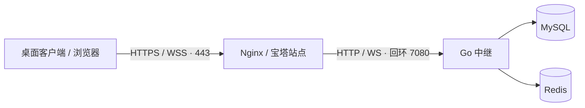

# Nginx / 宝塔与 HTTPS

中继本身只监听 HTTP。将域名根路径代理到 `127.0.0.1:7080`，同一站点就能提供 HTTPS 控制台、HTTP API 和 WSS。本文分成宝塔面板和自行管理 Nginx 两条路径，选择符合现有环境的一条。

## 代理前先通过源站检查

在运行中继的宿主执行：

```sh
curl --fail --silent --show-error http://127.0.0.1:7080/ready
```

预期 HTTP 200：

```json
{"protocol":1,"status":"ok"}
```

若此处失败，先修复中继 / 数据库，不必先改证书。确认公开配置为 `https://HOST`、`EMBEDDESK_COOKIE_SECURE=true`；已初始化节点的公开地址需在控制台修改。



::: warning 地址与路径
客户端使用 `https://HOST`，控制台使用 `https://HOST/console/`。不要把 `/console/` 填进节点公开地址，也不要加 `/relay/` 这样的额外前缀；当前实现要求在域名根路径提供 API 与 WebSocket。
:::

## 路线 A：在宝塔中创建并管理

以下步骤使用宝塔网站管理能力。站点、代理和证书都应保留在面板记录中，后续仍能从该站点设置修改。不同版本字段可能略有差异，以面板实际名称为准。

### 1. 创建或选择站点

1. 在「网站」中查看该域名是否已经存在；存在则进入原站点，不重复添加。
2. 没有站点时点击「添加站点」，域名填写 `HOST`。不需要新建 PHP / MySQL 应用，也不要覆盖其他业务的站点根目录。
3. 使用纯静态站点或面板提供的反向代理站点类型。数据库无需在此创建，Compose 已提供自己的 MySQL。
4. 保存后确认站点出现在网站列表，进入「设置」可看到域名、反向代理、SSL 等入口。

### 2. 配置根路径反向代理

在该站点「反向代理」添加规则：

| 字段 | 填写内容 |
| --- | --- |
| 代理名称 | 任意便于辨认的名称，例如 `embeddesk-relay` |
| 代理目录 / 路径 | `/` |
| 目标 URL | `http://127.0.0.1:7080` |
| 发送域名 / Host | 当前访问域名 `HOST`，保留实际 Host |
| 缓存 | 关闭 |
| WebSocket | 有开关则开启 |

添加后打开面板提供的代理配置编辑入口，检查下方的[必要代理指令](#必要代理指令)。不要重复添加已有 `location /` 或相同指令；将内容合并到该规则自动生成的代理块。

如果宿主映射端口不是 7080，同步修改目标 URL。若 Nginx 也在另一个容器中，`127.0.0.1` 指向的是该容器自身，需要根据实际网络配置选用可达的上游地址；本文默认 Nginx 运行在宿主。

### 3. 通过面板签发或上传证书

1. 确认域名 A / AAAA 记录都指向实际提供站点的主机；无效的 AAAA 记录也可能导致验证或客户端失败。
2. 打开站点「SSL」，选择面板支持的证书签发方式，或上传已有证书和匹配私钥。
3. HTTP 文件验证需要公网 80 能访问此站点的验证路径。不要让根代理或跳转吞掉面板的证书验证 location；遵循面板生成的验证配置。
4. DNS 验证按面板 DNS 插件要求授权或添加记录，不需要把 DNS API 凭据写进中继配置。
5. 签发完成后应用证书、启用 HTTPS；验证正常后再按需要开启强制 HTTPS。
6. 确认续期任务由宝塔管理，域名仍在站点列表内。

::: tip 证书归站点管理
中继不读取证书文件，不需要给 Go 容器挂载私钥。证书私钥只交给现有 Nginx / 宝塔；中继继续使用回环 HTTP。
:::

### 4. 验证修改仍由面板管理

保存并使用面板的配置检查 / 重载功能。重新进入该站点，确认反向代理目标和 SSL 证书都能查看、修改；不要另建一个面板外的同域名 `server` 块，否则可能出现面板显示与实际生效配置不一致。

然后在外部浏览器访问 `https://HOST/console/`。证书无警告、可以登录和保存节点设置后，再完成双客户端转发验证。

## 路线 B：自行管理 Nginx

在已有、证书有效的 HTTPS `server` 中合并仓库的 [deploy/nginx.conf.example](../../deploy/nginx.conf.example)。证书路径、HTTP 跳转和续期沿用当前管理方式。

### 必要代理指令

```nginx
location / {
    proxy_pass http://127.0.0.1:7080;
    proxy_http_version 1.1;
    proxy_set_header Host $http_host;
    proxy_set_header Upgrade $http_upgrade;
    proxy_set_header Connection "upgrade";
    proxy_read_timeout 120s;
    proxy_send_timeout 120s;
    proxy_buffering off;
    client_max_body_size 96k;
}
```

| 指令 | 原因 |
| --- | --- |
| HTTP/1.1、Upgrade、Connection | 允许设备通道升级到 WebSocket |
| 保留 Host | 控制台写接口校验 Origin 与公开地址，避免代理改成内部主机名 |
| 120 秒读写超时 | 大于协议 75 秒存活检测，避免代理先切断连接 |
| `proxy_buffering off` | 不缓存实时交互 |
| `client_max_body_size 96k` | 与当前 HTTP / 协议入口上限匹配 |

检查后平滑重载。自行管理且服务名为 `nginx` 的主机可执行：

```sh
sudo nginx -t
sudo systemctl reload nginx
```

宝塔管理的 Nginx 优先从面板检查和重载，避免调用到另一套系统 Nginx。公网只需开放 443，以及证书验证按需使用的 80；7080、MySQL 和 Redis 留在内部。

## 外部验收：从 HTTP 到真实 WSS

先检查外部路由与证书：

```sh
curl --fail --silent --show-error https://HOST/health
curl --fail --silent --show-error https://HOST/ready
curl --fail --silent --show-error https://HOST/api/console/auth/options
```

前两者预期 `{"protocol":1,"status":"ok"}`，第三个预期为注册开关，例如：

```json
{"registrationEnabled":false}
```

随后执行完整验收：

1. 浏览器打开 `/console/` 登录，并保存一次合法的中继设置，验证 Host / Origin 与 Cookie 正常。
2. 从「中继接入」复制当前代码，导入两台客户端并重新上线。
3. 用设备 ID 发起授权，实际打开对端已发布的 TCP / UDP 或串口服务。
4. 保持连接超过 2 分钟，确认没有固定周期的掉线。

::: details 为什么不能直接 curl WebSocket 地址来验收
`/v1/channel` 需要设备凭据和 `X-Device-ID`。无凭据直接请求得到 401 是正常认证行为，不代表代理坏了。浏览器控制台页面使用普通 HTTP API，也不能单独证明设备的 WSS Upgrade 成功；应以实际客户端上线、授权和转发为准。
:::

## 按现象快速定位

| 现象 | 先检查 | 处理方向 |
| --- | --- | --- |
| 502 Bad Gateway | 宿主 `/ready`、上游端口、容器状态 | 修复源站或代理目标 |
| 页面可开，保存返回 403 | 浏览器地址、节点公开 URL、代理 Host | 使用同一 HTTPS origin 并保留 Host |
| 页面可开，设备不上线 | Upgrade 头、证书链、当前连接代码 | 修复 WebSocket / 证书 / 准入过滤 |
| 固定几十秒掉线 | 代理读写超时、WebSocket 开关 | 保持 120 秒超时，检查心跳链路 |
| 签发失败 | DNS、80 验证路径、错误 AAAA、面板日志 | 先让验证请求到达正确站点 |

Cloudflare 普通代理前置后，数据仍会经过 Go 源站。希望卸载转发流量时，需要另一种 Worker / Durable Objects 数据面，见[边缘中继方案](../CloudflareRelay.md)。

## 迁移已有 HTTP 节点到 HTTPS

首次部署直接选择 HTTPS 最简单。已有 HTTP 节点需要同时迁移 Secure Cookie 和数据库中的公开地址：设置 `cookieSecure=true` 后旧 HTTP 网页无法使用 Cookie，而新 HTTPS 网页的写操作又可能被旧公开地址的 Origin 校验拒绝。

::: details 受控的管理员 API 迁移流程
此流程需要已有管理员凭据、已验证可用的 HTTPS 反向代理，以及维护机上的 curl 和 jq（仅维护工具，不是产品运行依赖）。在维护时段执行，过程中客户端可能重连。

1. 先确认 `https://HOST/ready` 成功，将启动环境的 Cookie 设为 `true`，公开启动 URL 设为 `https://HOST`，重建 / 重启中继。数据库旧公开地址仍保留。
2. 创建权限受限的临时目录：

```sh
umask 077
relay_migration_dir=$(mktemp -d)
```

3. 用私有编辑器在该目录创建 `login.json`，填写实际管理员登录 JSON；不要把密码直接写进 shell 命令：

```json
{"username":"admin","password":"REPLACE_WITH_EXISTING_ADMIN_PASSWORD"}
```

4. 通过 HTTPS 登录。curl 不添加浏览器的 `Origin` 头；服务器仍照常验证密码、会话和 CSRF：

```sh
curl --fail --silent --show-error \
  --cookie-jar "$relay_migration_dir/cookies.txt" \
  --header 'Content-Type: application/json' \
  --data-binary "@$relay_migration_dir/login.json" \
  https://HOST/api/console/auth/login > "$relay_migration_dir/login-response.json"
jq -er '.csrfToken | select(type == "string" and length > 0) | "X-CSRF-Token: " + .' "$relay_migration_dir/login-response.json" > "$relay_migration_dir/csrf-header.txt"
```

5. 在临时目录创建 `node.json`，内容为 `{"publicUrl":"https://HOST"}`，替换真实域名；保存新公开地址：

```sh
curl --fail --silent --show-error --request PATCH \
  --cookie "$relay_migration_dir/cookies.txt" \
  --header 'Content-Type: application/json' \
  --header "@$relay_migration_dir/csrf-header.txt" \
  --data-binary "@$relay_migration_dir/node.json" \
  https://HOST/api/console/relay > "$relay_migration_dir/node-response.json"
```

6. 在浏览器使用 HTTPS 重新登录，检查公开地址和连接代码。用完维护会话后调用退出接口，撤销它，而不仅是删除本地 Cookie：

```sh
curl --fail --silent --show-error \
  --cookie "$relay_migration_dir/cookies.txt" \
  --header 'Content-Type: application/json' \
  --header "@$relay_migration_dir/csrf-header.txt" \
  --data '{}' \
  https://HOST/api/console/auth/logout > "$relay_migration_dir/logout-response.json"
```

退出成功返回 `{"ok":true}`。即使地址变更失败，只要已取得有效维护会话，也应执行退出。之后删除专用临时目录中的登录、Cookie、CSRF 与响应文件，不保留它们为排查日志；重新分发当前连接代码。

如果节点原先已经使用 HTTPS，只更换为另一个 HTTPS 域名，可在原 HTTPS 控制台保存新公开地址，再从新域名重新登录；保留旧域名和证书直到迁移完成。
:::
