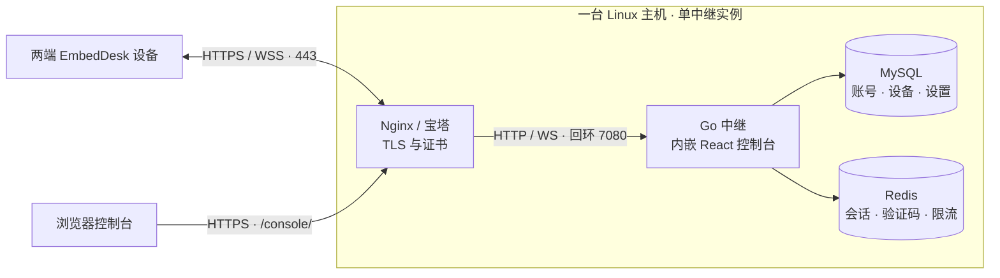

  GPL-3.0-only
  Go · Gin · GORM
  React · Ant Design
  单实例 · WebSocket

## 一个入口管理节点与设备

管理员先看服务器负载和中继带宽，再进入设备、会话和用户列表处理归属、连接与配额。注册用户只管理自己的设备，访客保留只读视图。

独立演示实例，图中为演示数据。点击图片查看原图；账号角色、设备绑定和批量管理见<a href="./reference/console">控制台指南</a>。

## 先看清部署后的链路

公网只开放 HTTPS 入口，中继在宿主回环监听 HTTP。设备的控制和加密数据共用 WebSocket；浏览器控制台与设备使用同一域名。MySQL 和 Redis 保持在私有网络中。

上图是推荐的 Compose 部署方式。小规模本机验证可使用 SQLite，也可在未配置 Redis 时把控制台会话和验证码保存到数据库。详见[配置与优先级](reference/configuration.md)。

## 从你的运行环境开始

| 你的环境或目标 | 选择的路径 | 部署后检查 |
| --- | --- | --- |
| 已有域名、Docker 和 Nginx / 宝塔 | [Docker Compose](deployment/docker.md) → [HTTPS 代理](deployment/nginx.md) | 就绪接口、控制台登录、双端转发 |
| 使用已有 MySQL / Redis，偏好 Linux 服务管理 | [单二进制与 systemd](deployment/binary.md) | 环境文件权限、systemd 日志、就绪接口 |
| 仅在可信内网临时验证 | [Docker 直接暴露端口](deployment/docker.md#直接暴露-docker-端口) | HTTP / WS 与 Cookie 设置保持一致 |
| 修改 Go 协议或 React 控制台 | [构建与验证](development/index.md) | 自动测试、构建产物、浏览器操作 |

## 按这个顺序完成首次部署

  

    
01 / 准备

    <h3>域名与私有配置</h3>
    
解析域名，准备有效证书，生成数据库、Redis 与首次管理员密码。

  

  

    
02 / 启动

    <h3>检查中继就绪</h3>
    
启动容器或 systemd；先从宿主访问 <code>/ready</code>，确认存储可用。

  

  

    
03 / 接入

    <h3>配置 HTTPS 与 WSS</h3>
    
代理全部根路径并保留 WebSocket Upgrade；登录后检查节点公开地址。

  

  

    
04 / 验收

    <h3>双端授权与转发</h3>
    
导入当前连接代码，完成双端测试；移除 Bootstrap 凭据并安排备份。

  

[打开完整快速开始 →](deployment/index.md) · [查看健康检查、备份与升级 →](reference/operations.md)

## 上线前，确认这些边界

  

    <h3>当前服务按单实例运行</h3>
    
设备路由、在线会话与共享限速保存在进程内存。共用 MySQL / Redis 不会自动组成集群，重启也不会恢复原有设备授权和转发会话。

  

  

    <h3>公共 Token 只做简单过滤</h3>
    
所有客户端共用节点准入令牌；它用于减少扫描，不是个人凭据。设备访问仍需密码或人工授权，公网链路需要 HTTPS / WSS。

  

  

    <h3>这里的 Pages 只提供文档</h3>
    
GitHub Pages 托管静态文档；完整中继程序仍需要部署在服务器运行。

  

  

    <h3>带宽按账号双向共享</h3>
    
绑定后同账号全部设备共享接收与发送合计预算；匿名设备每台独立使用默认值。监控统计加密数据正文，不等同于网卡总流量。

  

需要排查已有部署，先看[常见问题](reference/faq.md)；修改代码前阅读[设备协议与实现边界](DeviceConnections.md)。源码与贡献入口在 [GitHub](https://github.com/Daofengql/EmbedDesk.Relay)。
