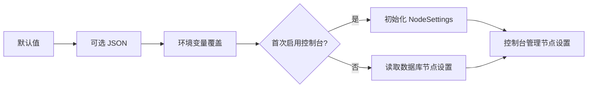

# 配置项与优先级

中继有两类配置：**进程启动配置**控制监听、存储和登录行为；**节点设置**控制客户端看到的名称、公开地址、公共准入过滤和默认带宽。区分它们，才能判断“应该改 `.env` 还是控制台”。

## 配置从哪里读取

按以下顺序加载：

1. 程序内默认值。
2. `EMBEDDESK_CONFIG` 指定的 JSON 文件（可选）。
3. 程序环境变量。
4. 首次启用控制台时，节点设置写入数据库；之后这些字段从数据库读取。



| 想修改什么 | 修改位置 | 生效方式 |
| --- | --- | --- |
| 监听端口、MySQL / Redis、Cookie、注册开关 | 启动环境 / JSON | 重启或重建中继 |
| 节点名称、公开地址、默认带宽 | 控制台「中继接入」→「中继设置」 | 保存到数据库 |
| 节点公共 Token | 控制台「刷新令牌」或过滤开关 | 后续注册使用新值 |
| 单个用户带宽与设备上限 | 控制台「用户管理」 | 按操作规则应用；改带宽会断开相关设备 |

::: warning 初始化后修改环境不等于修改节点
例如 `.env` 仍写 `1000000`，但控制台已保存 10 Mbps，重启后继续使用数据库的 10 Mbps。反过来，直接把 `.env` 改成 10 Mbps 也不会覆盖已有 NodeSettings。先确认字段属于哪一类。
:::

## 进程启动配置

| 环境变量 | JSON 字段 | 默认值 / 说明 |
| --- | --- | --- |
| `EMBEDDESK_CONFIG` | — | JSON 文件路径，最大 64 KiB，拒绝未知字段 |
| `EMBEDDESK_LISTEN` | `listen` | `127.0.0.1:7080`，必须为 `HOST:PORT`，仅 HTTP |
| `EMBEDDESK_DATABASE_DRIVER` | `databaseDriver` | `sqlite` 或 `mysql`，默认 `sqlite` |
| `EMBEDDESK_DATABASE` | `database` | `data/relay.sqlite`，仅 SQLite 使用 |
| `EMBEDDESK_MYSQL_DSN` | `mysqlDsn` | MySQL DSN，必须指定数据库 |
| `EMBEDDESK_REDIS_URL` | `redisUrl` | 可选 `redis://` / `rediss://` |
| `EMBEDDESK_REDIS_PREFIX` | `redisPrefix` | `embeddesk:`，不同部署使用不同前缀，最多 100 字符且无空白 |
| `EMBEDDESK_CONSOLE_ENABLED` | `consoleEnabled` | 默认 `false`；Compose 与开发示例为 `true` |
| `EMBEDDESK_REGISTRATION_ENABLED` | `registrationEnabled` | 默认 `false`，开启用户图片验证码注册，要求控制台已启用 |
| `EMBEDDESK_COOKIE_SECURE` | `cookieSecure` | 默认 `true`；可信 HTTP 开发才设为 `false` |
| `EMBEDDESK_BOOTSTRAP_USERNAME` | — | 空账号表的首个管理员用户名，只从环境读取 |
| `EMBEDDESK_BOOTSTRAP_PASSWORD` | — | 初始化密码，12–72 个 UTF-8 字节，只从环境读取 |

布尔值建议明确使用 `true` / `false`。Bootstrap 两个值必须同时提供或同时移除；控制台开启且没有可用管理员时会拒绝启动，不会悄悄创建无密码账号。

### 环境空值的区别

`LISTEN`、`DATABASE`、`ADMISSION_KEY`、`BANDWIDTH_BITS_PER_SECOND` 仅在对应环境变量**非空**时覆盖。其余表中的程序环境变量只要存在就会覆盖，包括空字符串；布尔变量空值会解析失败。

混用 JSON 与环境时，删除不需要的环境变量，不要假设空值都表示“沿用 JSON”。特别是 JSON 中有准入 key 时，空的 `EMBEDDESK_ADMISSION_KEY` 不会把它清空；已启用控制台则通过过滤开关管理。

### 数据库与 Redis

MySQL DSN 示例：

```dotenv
EMBEDDESK_MYSQL_DSN=embeddesk:REPLACE_WITH_DATABASE_PASSWORD@tcp(127.0.0.1:3306)/embeddesk?charset=utf8mb4
```

Compose 内主机名改为服务名 `mysql`；二进制连接宿主 MySQL 才通常使用 `127.0.0.1`。程序会启用时间解析、UTC 和连接超时，关闭多语句执行。

Redis URL 示例：

```dotenv
EMBEDDESK_REDIS_URL=redis://:REPLACE_WITH_REDIS_PASSWORD@127.0.0.1:6379/0
EMBEDDESK_REDIS_PREFIX=embeddesk:
```

Compose 内主机名使用 `redis`。Redis 密码含保留字符时按 URL 编码；不要把 MySQL 的 DSN 编码规则套到 Redis。远程存储的网络访问、TLS 和账号权限由部署者配置。

配置 Redis 后连接失败会阻止初始化，运行期间会话、验证码或登录保护存储不可用时相关请求返回 503，不跳过校验。未配置 Redis 则保存到数据库。Redis 不是跨实例设备路由或共享带宽引擎。

## 节点设置的初始值

| 环境变量 | JSON 字段 | 初始值 / 限制 |
| --- | --- | --- |
| `EMBEDDESK_RELAY_NAME` | `relayName` | `EmbedDesk 中继`，1–64 个 UTF-16 字符，无控制符 |
| `EMBEDDESK_PUBLIC_URL` | `publicUrl` | HTTP(S) 根地址，最大 2048 字符；空值不生成连接代码 |
| `EMBEDDESK_ADMISSION_KEY` | `admissionKey` | 默认空，最多 2048 个无空白的可见 ASCII 字符；控制台中只允许随机刷新 |
| `EMBEDDESK_BANDWIDTH_BITS_PER_SECOND` | `bandwidthBitsPerSecond` | 默认 `1000000`，范围 `8000`–`100000000000` bits/s |

公开 URL 合法形态是 `https://HOST`、`https://HOST:PORT` 或可信内网的 `http://HOST:PORT`。不能包含账号、查询参数、片段或 `/console/` 等路径。

| 想设置的带宽 | 启动配置 bits/s | 控制台 Mbps 输入 |
| --- | --- | --- |
| 1 Mbps | `1000000` | `1` |
| 10 Mbps | `10000000` | `10` |
| 100 Mbps | `100000000` | `100` |
| 4.096 Gbps | `4096000000` | `4096` |

单位按 1000 换算。默认带宽只提供新账号初值与每台匿名设备默认值；已有用户不被覆盖，在线匿名设备重连生效。详见[控制台与带宽](console.md)。

## 典型配置组合

::: details 本机 SQLite + HTTP 开发
复制 [config.example.json](../../config.example.json) 为不提交的 `relay.json`：

```json
{
  "listen": "127.0.0.1:7080",
  "database": "data/relay.sqlite",
  "databaseDriver": "sqlite",
  "consoleEnabled": true,
  "registrationEnabled": false,
  "cookieSecure": false,
  "publicUrl": "http://127.0.0.1:7080",
  "relayName": "本机开发中继",
  "admissionKey": "",
  "bandwidthBitsPerSecond": 1000000
}
```

在私有运行环境设置 `EMBEDDESK_CONFIG=relay.json` 与两项 Bootstrap 凭据后运行。相对路径基于进程工作目录，systemd 示例的工作目录是 `/var/lib/embeddesk`。
:::

::: details 公网 HTTPS + MySQL / Redis

```dotenv
EMBEDDESK_LISTEN=127.0.0.1:7080
EMBEDDESK_DATABASE_DRIVER=mysql
EMBEDDESK_MYSQL_DSN=embeddesk:REPLACE_WITH_DATABASE_PASSWORD@tcp(127.0.0.1:3306)/embeddesk?charset=utf8mb4
EMBEDDESK_REDIS_URL=redis://:REPLACE_WITH_REDIS_PASSWORD@127.0.0.1:6379/0
EMBEDDESK_CONSOLE_ENABLED=true
EMBEDDESK_REGISTRATION_ENABLED=false
EMBEDDESK_COOKIE_SECURE=true
EMBEDDESK_PUBLIC_URL=https://HOST
EMBEDDESK_BANDWIDTH_BITS_PER_SECOND=10000000
```

首次空库还需 Bootstrap 两项；完整环境与权限见 [systemd 教程](../deployment/binary.md)。Compose 不直接使用这个监听地址段，它在容器内监听 `0.0.0.0:7080`，由映射地址控制宿主暴露范围。
:::

## Compose 自身的变量

以下值由 Compose 读取，不是 Go 程序直接配置：

| 变量 | 用途 |
| --- | --- |
| `EMBEDDESK_BIND_ADDRESS` | 宿主映射地址，默认 `127.0.0.1` |
| `EMBEDDESK_PORT` | 宿主 HTTP 映射端口，默认 `7080` |
| `EMBEDDESK_IMAGE` | 镜像名，默认 `embeddesk-relay:local` |
| `MYSQL_PASSWORD` / `MYSQL_ROOT_PASSWORD` | MySQL 容器首次初始化密码 |
| `REDIS_PASSWORD` | Redis 容器密码，需与 Redis URL 同步 |

`.env` 会先由 Compose 插值，再通过 `environment` 传进容器。当前 shell 同名变量也可能覆盖 `.env` 的插值结果，出现意外时先检查自己的运行环境。`docker compose config --quiet` 可检查缺失变量而不输出完整凭据。

::: warning 已有 MySQL 数据卷改密
MySQL 官方镜像只在空数据目录初始化账号。修改 `.env` 的 `MYSQL_PASSWORD` 不会更新已有账号密码，应先用数据库管理流程完成改密，再同步中继 DSN。不要删除卷来让初始化重新执行。
:::

已有 HTTP 节点迁往 HTTPS 时，公开地址和 Secure Cookie 需要同步处理，见 [已有 HTTP 节点迁移](../deployment/nginx.md#迁移已有-http-节点到-https)。新部署直接使用 HTTPS 无需迁移。
